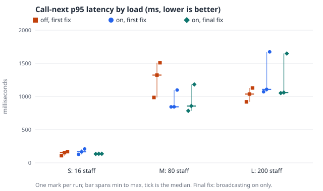
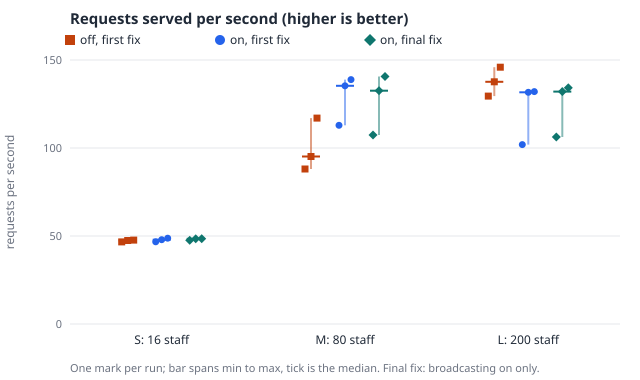

# Load and correctness report

Antre is a queue app (Laravel, Postgres, websockets). This is a load test of a copy I ran myself, and an account of the one real bug it exposed. Everything below comes from the saved run data in `results/` (45 runs, 3 per cell, per code version). Numbers are relative, not capacity claims.

## Short version

- **Integrity held.** 8 invariants (no ticket called twice, no repeated ticket numbers, and so on) were checked from the database after every run: **0 violations in all 45 runs**, from 16 to 200 staff.
- **The queue does not drain at medium and large load.** The ninth check ("the queue is empty at the end") fails in all 30 M and L runs. That is capacity: staff cannot call tickets as fast as the queue is filled and seeded in a 120 s window. It is not a data error.
- **The test found a real bug.** TV displays could show a screen that went backwards, or two different screens under one version number. Three rounds of fixes later, both counts are **0 in all 9 final runs**.
- **One number is not clean and I am not hiding it.** At M and L the TV's last screen differs from the database in 120 of 120 clients (M) and 250 of 274 (L), summed over 3 runs, but in 0 of 30 at S. I believe this is a moving target at the end of the run, not wrong content, but I have not proven it (see "The TV ordering bug").
- **L is not a clean 200-staff run.** About a third of staff logins failed at L and were not retried, so fewer staff were actually working. I report L as it ran, not as a ceiling.
- **Latency is noisy.** The same config varied more than 2x between runs on the shared runner, so I make no speed-up claims.

## What was tested, and on what

- **Hardware:** one GitHub-hosted `ubuntu-latest` runner (4 vCPU) shared by everything: k6, the app (Apache with mod_php, **no opcache**, so PHP is slower than the demo), Postgres 17 and Reverb (websockets). The load generator competes with the system under test, so treat numbers as relative to each other.
- **Never run against production.** The demo runs on Ably, a different stack. The scripts refuse any host that is not local, and `load-test.yml` is manual (`workflow_dispatch`) only.
- **Three sizes**, all 4 counters per branch, 500 waiting tickets per branch, 20 s ramp, 60 s hold, then up to 120 s for staff to drain:

| Size | Branches | Staff | Walk-ins/s | TV clients |
| --- | --- | --- | --- | --- |
| S | 2 | 16 | 5 | 10 |
| M | 10 | 80 | 20 | 40 |
| L | 25 | 200 | 50 | 100 |

- **Staff** press call next (15% of presses doubled, like a double click), then recall, skip or done. **Walk-ins** take and sometimes cancel tickets. **Bookings** are checked in, some twice. **TV clients** listen on websockets and replay each snapshot through the TV's real accept rule.
- The first two code versions (`5d4ae5e`, `ecd5e27`) ran each size with broadcasting on and off, 3 runs each (36 runs); the final code was run with broadcasting on only (9 runs).

## Correctness

After each run `antre:loadtest-check` reads the database, not what k6 says. Eight checks, **0 violations in 45 of 45 runs**:

1. every ticket that reached a counter has exactly one call
2. no ticket was called more than once
3. no ticket was called on two counters
4. a ticket never called has no call and no counter
5. the counter on a ticket is the one that called it
6. no counter holds two called tickets
7. ticket numbers are not repeated within a service and day
8. every checked-in booking has exactly one ticket

A ninth check, "nothing is left waiting or called", passes at S and **fails at M and L in all 30 runs (every M and L run, three code versions)**. Why this is capacity, from the data:

- At S, 16 staff made about 87 calls each (1,388 to 1,398 calls) and the queue emptied.
- At M, 80 staff made about 43 calls each (median 3,459) and 2,750 to 3,810 tickets were still waiting. At L, 200 staff made about 18 each (median 3,504) and 12,098 to 12,795 were still waiting. But 116 to 145 of about 425 logins failed in each final L run (102 to 195 across all 15 L runs). load.js does not retry a failed login, and 2 to 4 of the 25 branches never called a ticket, so L ran with well under 200 working staff.
- Median call-next latency (whole run, median of 3 runs) rose from 28 ms (S) to 563 ms (M) to 684 ms (L), so staff spent their time waiting on responses. The queue is simply larger than the system can call down in the window.

## Results

Final code (`22c6efd`), broadcasting on, median of 3 runs (min to max):

| Size | Calls | Call-next p95 (ms) | Requests/s | Error rate | Walk-in p95 (ms) | Peak PG connections | Queue drained |
| --- | --- | --- | --- | --- | --- | --- | --- |
| S | 1,394 (1,388 to 1,398) | 136 (134 to 136) | 48.4 | 0% | 31 | 18 | yes |
| M | 3,459 (2,651 to 3,735) | 857 (784 to 1,182) | 132.6 | 0% (0 to 0.2%) | 640 | 82 to 85 | no |
| L | 3,504 (2,438 to 3,538) | 1,059 (1,051 to 1,647) | 132.1 | 0.9% (0.7 to 2.4%) | 667 | 97 to 100 | no |

For comparison, first-fix code (`ecd5e27`) with broadcasting off: call-next p95 S 154, M 1,323, L 1,037 ms; requests/s S 47.5, M 95.2, L 137.6. Broadcasting off was **slower** than on at M, which is noise, not a finding. At L the call-next p99 was 43 to 52 s in all 15 L runs, so the tail is very long once the system saturates.

Throughput stops growing between M and L (about 130 requests/s at both). Part of that is saturation and part is the failed logins at L, so I do not read L as a ceiling.

## Where the time goes

| Finding | Status |
| --- | --- |
| The hot statement is the row lock on the counter (`select ... from counters ... for update`). Its mean time rises from about 3.6 ms (S) to 38 ms (M, run 1) and 53 ms (L, run 1); the ticket lock and the per-branch version update follow. | measured |
| Most held connections were idle: sampled peaks of 5 to 40 active queries (M and L) against up to 100 connections held, and the cheap statements average 0.03 to 1 ms. | measured |
| So the lock waits are a **symptom**: transactions hold the counter lock longer because the PHP process doing the work is starved for CPU on the shared 4 vCPU box (no opcache, k6 on the same machine). | inferred, no CPU samples were collected |
| At L the app held 100 Postgres connections (the default limit) while Apache's default allows 150 workers. The app log shows Postgres refusing connections ("too many clients") 173 to 199 times per final L run, and 43 times in the M run with 0.2% errors (all of its failures). The connection peaks are sampled about every 2 s and miss the true maximum. | measured (app log); Apache default inferred |
| Per-request database chatter: every request writes the session row (10,201 session updates for 10,291 requests in `s-on-1`, before run), and the same two `count(*)` queries ran 11,234 times for 3,459 calls in `m-on-1`. Each is cheap but they multiply. | counts measured; the share of total cost inferred |
| Broadcasting: no effect I can separate from run-to-run noise (runs of one identical config varied 1,973 to 4,396 calls). Delivery to TVs took 9 to 93 ms p95 in 8 of 9 final runs, one L run 153 ms. | measured; "cost is small" inferred |

## The TV ordering bug

Each branch's TV display receives snapshots over a websocket. I wanted to see what viewers see under load, so the k6 TV clients log every snapshot.

1. **Exposed.** The first data (`5d4ae5e`) showed arrivals going back in version (350, 1,132 and 620) and different content arriving under the same version (60, 69 and 6 cases at S, M and L, summed over 3 runs). The version was the wall clock in milliseconds, so two counters changing in the same millisecond got one number.
2. **First fix** ([389d879](https://github.com/ramaraihan12/antre/commit/389d879), [efcece0](https://github.com/ramaraihan12/antre/commit/efcece0), [ecd5e27](https://github.com/ramaraihan12/antre/commit/ecd5e27)): a per-branch counter bumped inside each queue transaction, and the TV only takes strictly newer versions. **The data showed this was incomplete**: same-version-different-content did not go away (53, 145 and 111 at S, M and L), because the snapshot was still rebuilt after the commit, so a version could carry the next change's rows.
3. **Second fix** ([348a468](https://github.com/ramaraihan12/antre/commit/348a468)): the version and the content are built in one transaction under the branch lock and sent after commit; page load reads both in one REPEATABLE READ read; recall takes locks in the same order as call-next.
4. **The metric had to be corrected too.** Counting raw out-of-order arrivals is not what a viewer sees, since the TV ignores older arrivals. The client now replays arrivals through the TV's accept rule and counts screens that went backwards. Later fixes to the metric itself: [9654302](https://github.com/ramaraihan12/antre/commit/9654302) judge by what only moves forward, [a01119f](https://github.com/ramaraihan12/antre/commit/a01119f) call log ordered under the branch lock and one client per connection in `tv_order.py`, [a0fc200](https://github.com/ramaraihan12/antre/commit/a0fc200) recent calls compared by position (a ticket recalled twice at one counter was misread as older), [22c6efd](https://github.com/ramaraihan12/antre/commit/22c6efd) a full recent list no longer counts as an advance.

Viewer-facing metrics, broadcasting on, summed over 3 runs per size (S / M / L). The first two columns are the k6 client's own counts. The final column is `tv_order.py`. Running `tv_order.py` on the older logs gives different numbers, because those logs have no connection id: before M same-version 73, first fix 69/193/127, and screens going backwards 10/28/28 for the first fix. Those logs predate the call-log ordering fix, so I do not compare them.

| Metric | Before `5d4ae5e` | First fix `ecd5e27` | Final `22c6efd` |
| --- | --- | --- | --- |
| Same version, different content | 60 / 69 / 6 | 53 / 145 / 111 | **0 / 0 / 0** |
| Screens that went backwards (replayed through the accept rule) | not measured | not measured | **0 / 0 / 0** (all 9 runs) |
| Raw out-of-order arrivals (informational; the TV ignores them) | 350 / 1,132 / 620 | 768 / 1,665 / 1,276 | 12 / 87 / 76 |
| Last screen differs from the database at the end | not measured | not measured | 0 of 30 / 120 of 120 / 250 of 274 |
| TV delivery p95, median of 3 runs (ms) | 9 / 29 / 61 | 8 / 31 / 37 | 10 / 58 / 62 |

Two things I want to be straight about:

- **The last row is not zero at M and L and I have not proven why.** In those runs the queue never drains, load.js stops drain staff 5 s before the TVs disconnect, but requests still in flight kept changing the database. In every mismatched client the database's final version is stamped after the last snapshot any TV in that run received (M 0.4 to 2.0 s later, L 1.2 to 10.7 s), and it is ahead of the screen by 0.5 to 2.4 s (M) and 2.2 to 12 s (L); no client was ever ahead of the database, and S, which drains and goes idle, matches fully. That points to a moving target, not wrong content, but the 5 s quiet window did not hold at M and L, and I have not run a longer one. Until then it is an open question, not a pass.
- **Delivery got slower at M and L** (median 58 against 31 ms, and 62 against 37 ms). Part of that is the timestamp now being taken when the snapshot is built inside the transaction, so it includes the wait for commit; part may be the longer per-branch lock. I did not separate the two. The older runs have no database display state, so no final comparison exists for them.

## What was NOT tested

- No run against production, no real network latency, no real browsers beyond a smoke test (see below); websocket clients are k6 scripts.
- No dedicated hardware: one shared 4 vCPU runner. Numbers are relative and cannot be read as a capacity figure for the demo, which runs a different stack (opcache, Ably).
- No CPU or memory sampling, so "CPU-bound on the PHP side" is inferred, not measured.
- Load only up to 200 staff, 50 walk-ins a second, 100 TV clients; one run length (60 s hold). No soak run, no failure injection (database restart, dropped websockets).
- The end-of-run TV comparison with a settled end state (see above).
- Production got a logged-out smoke check only (join page, TV display connects, staff login reaches the console). Nothing was created and no load was sent.

## How to reproduce

- Run the workflow: [Actions, load-test](https://github.com/ramaraihan12/antre/actions/workflows/load-test.yml), "Run workflow". It builds the repo's Dockerfile, so it is the same image each time.
- Inputs: `branches`, `counters_per_branch`, `staff_vus`, `tickets_per_branch`, `walkins_per_second`, `tv_clients`, `ramp_seconds`, `duration_seconds`, `drain_seconds`, `broadcasting`. The sizes above are S: 2 branches, 16 staff; M: 10 branches, 80 staff; L: 25 branches, 200 staff. Up to 4 runs at a time.
- Each run uploads an artifact (k6 summary, checker output, Postgres stats, `tv-snapshots.log`).
- TV replay over downloaded artifacts: `python loadtest/tv_order.py DIR`.
- Charts from the saved results: `python loadtest/charts.py`.
- Details of the scripts and the snapshot log are in [README.md](README.md).
